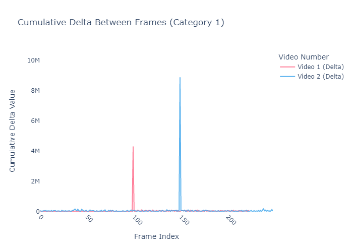

# Scene-cut detection with frame histograms

A video scene-boundary detector using grayscale intensity distributions. Consecutive frames are summarized as 256-bin histograms and cumulative histograms; changes between distributions are used to identify likely cut locations.

## Implementation

| File | Responsibility |
|---|---|
| [`ex1.py`](ex1.py) | Video decoding, histogram comparison, scene-cut selection |
| [`plot_and_test.py`](plot_and_test.py) | Diagnostic plots and experiments over multiple videos |

## Results



[Additional cumulative-histogram visualization](../assets/scene-cut-transition.png) · [Technical report](report.pdf)

## Running

The entry point accepts a local video path and the legacy `video_type` parameter:

```powershell
python -c "from ex1 import main; print(main('video.mp4', 1))"
```

A compatible local video is required. The parameter `video_type` is retained in the implementation but does not select a different detector in the inspected version. MediaPy and NumPy are required; see the repository-level `requirements.txt`.

**Skills:** video decoding, distribution-based change detection, cumulative histograms, experimental analysis.
