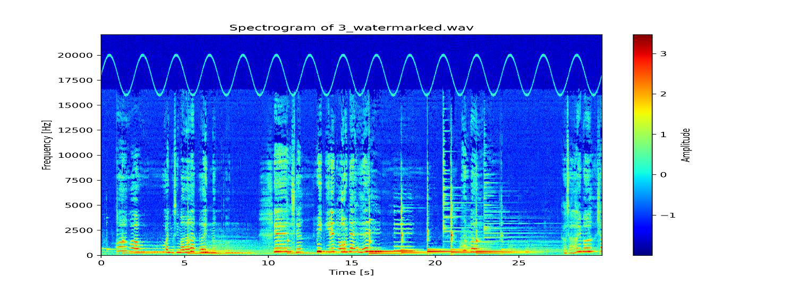

# Audio Fourier analysis and watermarking

Experiments in audio watermark embedding and detection using time-frequency analysis. The implementation studies sinusoidal watermark patterns, spectrograms, frequency-domain classification, and audio speed transformations.

## Implementation

[`ex2.py`](ex2.py) includes these experimental functions:

- `task1_watermarking`: watermark signal insertion.
- `task2_spectrograms`: short-time Fourier analysis and visualization.
- `task2_watermark_classification`: spectral detection/classification.
- `task3_speedup_method`: audio playback-speed transformations.

## Results

[STFT peak experiment](../assets/watermark-stft-peaks.png) · [Technical report](report.pdf)

## Inputs and execution

The original driver expects WAV files under `Task 1/`, `Task 2/`, and `Task 3/`. Those media assets are not included. Individual functions can be called with suitable input, or the driver paths can be adjusted to local WAV files.

**Skills:** FFT/STFT, spectral visualization, signal synthesis, audio watermark detection, and frequency-domain reasoning.
