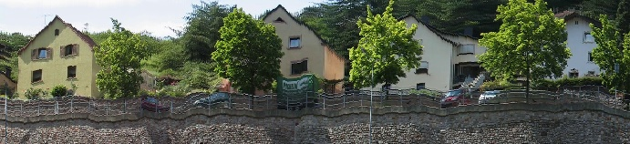

# Video stabilization and mosaicing

Feature-based alignment of video frames to estimate camera motion, stabilize an image sequence, and compose a mosaic from selected aligned strips.

## Processing stages

1. Detect and match local features (SIFT-based experiments).
2. Estimate pairwise geometric transformations and reject mismatches.
3. Accumulate inter-frame transforms to align images into a common reference.
4. Stabilize and select strips to construct the final mosaic.

## Implementations

The folder contains related experimental paths rather than a single interchangeable API:

| File | Role |
|---|---|
| [`ex4.py`](ex4.py) | Video mosaicing pipeline, frame transforms, panorama generation |
| [`main.py`](main.py) | Alignment and video-stabilization experiment |
| [`try.py`](try.py) | Static panorama from stabilized frame strips |
| [`frames_extractor.py`](frames_extractor.py) | Video frame extraction helper |

## Result

[Technical report](report.pdf)

## Environment

Requires Python, NumPy, OpenCV with SIFT support, and compatible video input. The scripts reference media paths such as `viewpoint_input.mp4` and `inputs/boat.mp4`, and may write under `outputs/`. Input footage is not bundled. Set local paths and create output directories as needed; results may depend on sequence content and camera motion.

**Skills:** image registration, feature matching, robust transform estimation, motion smoothing, frame warping, and panorama composition.
